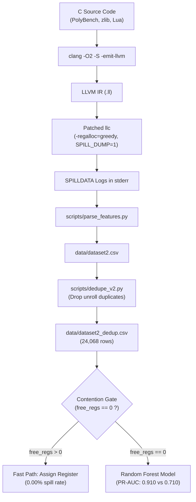

# ML-Guided Spill Prediction for LLVM Register Allocation

An empirical machine learning research platform predicting whether LLVM's Greedy Register Allocator (**LLVM 19.1.7, x86-64 target**) spills a virtual register live interval to stack memory, using features captured directly at the allocator's decision points.

---

## ⚡ Quick Start: Full-Stack Web Dashboard

The project includes an interactive compiler intelligence web dashboard powered by a **FastAPI** backend and a **React 19 + Tailwind CSS + Framer Motion** frontend.

```
┌────────────────────────────────────────────────────────────────────────┐
│  ⚡ SPILL-ML  |  LLVM 19.1.7 Greedy Register Allocation ML Lab         │
├─────────────┬──────────────────────────────────────────────────────────┤
│ Navigation  │ [1] Architecture   [2] Live Predictor   [3] Benchmarks   │
│             │ [4] Data Explorer  [5] LLVM Patch       [⌘K Search]      │
└─────────────┴──────────────────────────────────────────────────────────┘
```

### Launch in One Command (Production Mode):
```bash
python run.py
```
*or on Windows PowerShell:*
```powershell
.\start.ps1
```
- **Web Dashboard**: [http://127.0.0.1:8000](http://127.0.0.1:8000)
- **Interactive Swagger API Docs**: [http://127.0.0.1:8000/docs](http://127.0.0.1:8000/docs)

*(The Python runner automatically initializes the in-memory dataset, trains the Random Forest classifier, and serves both the REST API and the compiled React frontend on a single port with zero configuration.)*

### Hot-Reload Development Mode:
```bash
python run.py --dev
```
- **React Dev Server (Vite HMR)**: [http://localhost:5173](http://localhost:5173)
- **FastAPI API**: [http://127.0.0.1:8000](http://127.0.0.1:8000)

---

## 🖥️ Full Explanation of the Web Dashboard

The dashboard provides an intuitive, interactive window into the compiler optimization pipeline, empirical datasets, and machine learning models:

### 1. Architecture & Pipeline Overview (`PipelineOverview.jsx`)
- **Key Performance Indicators (KPIs)**:
  - **77.6% Gate Recall Ceiling**: 746 of 961 total spills are captured at first visit by checking physical register availability.
  - **0.910 Hard Intervals PR-AUC**: Random Forest vs. 0.710 for LLVM's static spill-weight heuristic (+28.2% boost).
  - **0.719 End-to-End PR-AUC**: Gate + ML Model vs. 0.112 for LLVM's native weight heuristic (+542% relative improvement).
  - **18,628 Spillable Live Intervals**: Recorded across 80 programs in PolyBench, zlib, and Lua.
- **5-Stage Interactive Compiler Pipeline**: Click through each stage (`C Sources` $\to$ `Clang -O2` $\to$ `LLVM IR` $\to$ `Patched LLC` $\to$ `Feature Extractor & Gate` $\to$ `Model Inference`) to inspect compiler transformations and instrumentation logic.
- **The "Free Register Gate" Breakthrough Card**:
  - `Free Regs > 0 (Fast Path)`: **0.00% immediate spill rate** (0 out of 16,429 intervals with free physical registers spilled).
  - `Free Regs == 0 (Contention Gate)`: **43.70% spill rate** (961 out of 2,199 saturated intervals spilled).
  - **Eviction Cascades**: Highlights the 215 intervals that initially received a free register but were evicted in later allocation passes when heavier intervals arrived.
- **x86-64 Register Class Contention Chart**: Bar chart showing that `GR64` (64-bit general purpose registers) accounts for **63.8% of all spills (613 spills)**, followed by `GR32` and `FR64`.

---

### 2. Live Spill Predictor & Allocator Simulator (`LivePredictor.jsx`)
An interactive sandbox simulating LLVM's register allocator decision point in real-time:
- **Workload Presets**:
  - `Matrix Multiply (Contention)`: High-contention PolyBench workload (`GR64`, 0 free regs, large live size).
  - `Inner Loop Index (Heavy)`: Deeply nested loop variable with high spill weight and loop reference count.
  - `Call Boundary Scalar`: Crosses call site register masks (`crosses_mask = 1`).
  - `Free Register Fast-Path`: Demonstrates immediate gate bypass when physical registers exist.
- **Adjustable Live Interval Parameters**:
  - **Free Hardware Registers** ($0$ to $16$): Watch the Contention Gate switch between *Fast Path* and *High Contention* dynamically.
  - **LLVM Spill Weight**: Logarithmic slider ($0.0001$ to $0.0800$).
  - **Live Interval Span Size**: $50$ to $12,000$ machine instructions spanned.
  - **Loop Nesting Depth** ($0$ to $5$): Maximum nesting depth of uses and defs.
  - **Non-Debug Uses & Defs**: Instruction operands count.
  - **Register Class**: Select between `GR64`, `GR32`, `VR128`, `FR64`, `GR8`.
  - **Call Register Mask Toggle**: Toggles interference with caller-saved registers.
  - **Classification Threshold ($\tau$)**: Slider from $0.1$ to $0.9$.
- **x86-64 Physical Register Hardware Matrix (`PhysicalRegisterBoard.jsx`)**:
  - Interactive grid displaying all 16 physical registers: `RAX`, `RBX`, `RCX`, `RDX`, `RSI`, `RDI`, `RBP`, `RSP`, `R8`, `R9`, `R10`, `R11`, `R12`, `R13`, `R14`, `R15`.
  - Registers dynamically glow green with **`IK_FREE`** or turn red/slate with **`OCCUPIED`** status based on the slider.
  - **Stack Memory Spill Slot (`[RSP + 0x18]`)**: Visualizes memory store instructions generated when a spill occurs.
- **Prediction Cockpit**:
  - Real-time **Spill Probability Gauge** (0% to 100%) with dynamic risk coloring.
  - Model Recommendation badge (`SPILL TO STACK SLOT` vs. `ASSIGN PHYSICAL REGISTER`).
  - **Compiler Action Advice**: Practical recommendations (e.g. *"Split live range outside inner loop before spilling"*).
  - **SHAP-Style Decision Drivers**: Top positive and negative contributors to the model's decision.

---

### 3. Model Benchmark & Evaluation Hub (`BenchmarkHub.jsx`)
- **Model Leaderboard**: Side-by-side comparison across 5 models:
  | Model Architecture | ROC-AUC (± std) | PR-AUC (± std) | Gain vs. LLVM Baseline |
  | :--- | :---: | :---: | :---: |
  | **Random Forest** | **0.953 ± 0.011** | **0.770 ± 0.046** | **+147%** |
  | **Gradient Boosting** | **0.956 ± 0.011** | **0.757 ± 0.039** | **+143%** |
  | **Decision Tree** | 0.894 ± 0.025 | 0.508 ± 0.066 | +63% |
  | **Logistic Regression** | 0.869 ± 0.031 | 0.486 ± 0.067 | +56% |
  | **LLVM Spill-Weight Baseline** | 0.829 ± 0.009 | 0.312 ± 0.045 | Baseline |
- **5-Fold Program-Grouped CV Chart**: Interactive bar chart proving Random Forest beats the baseline in **5 out of 5 folds** (mean PR-AUC **0.913** vs. **0.710**).
- **Interactive Threshold Optimizer**: Interactive tabs for $\tau = 0.3$, $0.5$, and $0.7$ showing dynamic Precision, Recall, F1 scores, and flagged counts.
- **Leave-One-Project-Out Generalization Cards**:
  - **PolyBench 4.2.1**: Model PR-AUC **0.871** vs. Baseline **0.784** (+11.1%).
  - **zlib**: Model PR-AUC **0.887** vs. Baseline **0.663** (+33.8%).
  - **Lua Bytecode VM**: Model PR-AUC **0.781** vs. Baseline **0.703** (+11.1%).
- **End-to-End Pipeline Comparison**: Visual bar chart showing how Gate + Model ($0.719$) outperforms Gate + Weight ($0.564$), Weight Only ($0.112$), and Random Guess ($0.052$).

---

### 4. Dataset & Live Interval Explorer (`DatasetExplorer.jsx`)
- **Feature Space Scatter Plot**: Interactive chart plotting $\log_{10}(\text{Live Size})$ vs. $\log_{10}(\text{Weight})$, colored by spilled (red) vs. kept (cyan) with detailed tooltips on hover.
- **Multi-Filter & Search Bar**: Filter all **24,068 intervals** by program name, benchmark project (`PolyBench`, `zlib`, `Lua`), register class, spill status, or contention gate status.
- **Paginated Data Table**: Inspect individual virtual registers (`%vreg`), live size, spill weight, uses, defs, max loop depth, free registers, and allocator visitation counts.

---

### 5. LLVM C++ Patch Inspector (`PatchInspector.jsx`)
- Interactive syntax-highlighted walkthrough of `patches/spill_dump.patch` targeting `llvm/lib/CodeGen/RegAllocGreedy.cpp`:
  - `spillDumpEnabled()`: Safe runtime toggle via `SPILL_DUMP=1`.
  - `dumpSpillFeatures(...)`: Traversing machine operands and querying `MachineLoopInfo::getLoopDepth()`.
  - `AllocationOrder` & `LiveRegMatrix::IK_Free`: Physical register availability checks.
  - `RAGreedy::selectOrSplitImpl`: The primary allocator intercept hook.
- One-click copy button and instructions on how to rebuild `llc` with Ninja.

---

### 6. Command Palette (`⌘K` / `Ctrl+K`)
- Press **`Ctrl + K`** (or **`⌘ + K`** on macOS) from any screen to open a spotlight search bar.
- Quickly navigate between dashboard views, load preset workloads, and trigger evaluations using keyboard navigation (`↑`/`↓` and `Enter`).

---

## 🛠️ How It Is Made (Architecture & Tech Stack)

### Frontend Stack:
- **Framework**: **React 19** with **Vite 8**
- **Styling**: **Tailwind CSS 3.4** with custom dark compiler theme and engineering grid patterns
- **Motion & Interactions**: **Framer Motion 14** (spring animations, gliding active layout pills, page transitions)
- **Smooth Inertia Scrolling**: **Lenis 1.3** with exponential deceleration curve
- **Charts & Data Visualizations**: **Recharts 3.10** (bar charts, scatter plots, custom tooltips)
- **Icons**: **Lucide React**

### Backend Stack:
- **API Framework**: **FastAPI 0.136** with **Uvicorn 0.48**
- **Data Validation & Schemas**: **Pydantic 2.13**
- **Machine Learning Engine**: **scikit-learn 1.9** (`RandomForestClassifier`, 150 estimators, balanced class weights)
- **Data Processing**: **Pandas 3.0** & **NumPy 2.4**
- **Unified Static Serving**: FastAPI mounts `frontend/dist` at root `/` to serve the entire full-stack app from a single Python process.

---

## 🔬 Scientific Methodology & Dataset Details



### Dataset Summary:
- **Main Dataset**: `data/dataset2_dedup.csv` (24,068 live intervals across 80 programs, identical loop-unrolled copies removed via AST hashing).
- **Spillable Intervals**: 18,628 intervals; 961 actual spills (5.16% spill rate).
- **First-Visit Snapshot**: `data/dataset3_first.csv` (features recorded on initial visit, tracking subsequent eviction cascades).

### Key Empirical Findings:
1. **The Contention Gate**: Saturated physical registers (`free_regs == 0`) are a strict prerequisite for spills at decision time. Saturated intervals have a **43.70% spill rate**, while intervals with free registers have a **0.00% immediate spill rate**.
2. **First-Visit Gate Ceiling**: Captures **77.6% of all spills (746 / 961)** on first pass. The remaining 215 spills occur due to eviction cascades after initial assignment.
3. **5-Fold Grouped Cross-Validation**: Live intervals from the same program are strictly grouped together (`GroupKFold`) to prevent data leakage. Random Forest beats LLVM's spill weight ranking in **5 out of 5 folds** (PR-AUC **0.913** vs. **0.710**).
4. **End-to-End Performance**: Gate + Model reaches **0.719 PR-AUC** vs. **0.112** for LLVM's native weight heuristic (+542% improvement).

---

## 📁 Repository Directory Structure

```
spill-ml/
├── backend/
│   ├── app.py                 # FastAPI REST API + Static Asset Serving
│   ├── model_service.py       # Random Forest model & SHAP explainability
│   └── data_service.py        # In-memory dataset indexer & distribution service
├── frontend/
│   ├── dist/                  # Optimized production frontend bundle
│   ├── src/
│   │   ├── components/
│   │   │   ├── Navbar.jsx            # Gliding Framer Motion nav & API status pill
│   │   │   ├── PipelineOverview.jsx  # Interactive 5-stage pipeline & discovery KPIs
│   │   │   ├── LivePredictor.jsx     # Real-time allocator sandbox & gauges
│   │   │   ├── PhysicalRegisterBoard.jsx # 16 x86-64 physical CPU register matrix
│   │   │   ├── BenchmarkHub.jsx      # Model leaderboard, 5-fold CV & leave-one-out
│   │   │   ├── DatasetExplorer.jsx   # Searchable data grid of 24,068 intervals
│   │   │   ├── PatchInspector.jsx    # Syntax-highlighted C++ patch viewer
│   │   │   ├── CommandPalette.jsx    # Spotlight search modal (⌘K / Ctrl+K)
│   │   │   └── MetricCard.jsx        # Glassmorphic statistic card
│   │   ├── context/
│   │   │   └── ToastContext.jsx      # Animated toast notifications
│   │   ├── services/
│   │   │   └── api.js                # API service with client-side fallback inference
│   │   ├── utils/
│   │   │   └── scroll.js             # Lenis inertia scroll configuration
│   │   ├── App.jsx                   # Main layout controller
│   │   └── index.css                 # Custom compiler grid & typography
│   ├── package.json
│   ├── tailwind.config.js
│   └── vite.config.js
├── data/
│   ├── dataset2.csv            # Raw dumped intervals
│   ├── dataset2_dedup.csv      # Deduplicated dataset (24,068 rows)
│   └── dataset3_first.csv      # First-visit snapshots
├── patches/
│   └── spill_dump.patch        # LLVM 19.1.7 C++ instrumentation patch
├── results/
│   ├── model_comparison.csv    # Benchmark numbers across 5 algorithms
│   ├── first_eval.txt          # First-visit gate and 5-fold evaluation output
│   ├── leave_project_out.txt   # Generalization results across benchmark suites
│   ├── end_to_end_fair.txt     # End-to-end PR-AUC comparison logs
│   ├── ablation.txt            # Feature ablation results
│   └── *.png                   # Permutation importance plots
├── scripts/
│   ├── fair_eval.py            # 5-fold GroupKFold evaluation on hard intervals
│   ├── first_eval.py           # First-visit gate and leave-one-project-out
│   ├── leave_project_out.py    # Generalization test across benchmark suites
│   ├── end_to_end_fair.py      # End-to-end pipeline comparison
│   ├── ablation.py             # Feature ablation study (Set A vs Set B)
│   ├── dedupe_v2.py            # Hashes program intervals to remove unrolled copies
│   ├── parse_features.py       # Runs llc on IR files, extracts SPILLDATA CSV
│   └── train_v2.py             # Model training & permutation importance
├── requirements.txt            # Python dependencies (FastAPI, scikit-learn, etc.)
├── run.py                      # Single-command full-stack launcher
├── start.ps1                   # Windows PowerShell launcher
└── README.md                   # This documentation
```

---

## 🧪 Running the Offline Python Scripts

If you want to run the raw evaluation scripts in a terminal without the web UI:

```bash
python scripts/fair_eval.py
python scripts/leave_project_out.py
python scripts/end_to_end_fair.py
python scripts/ablation.py
```

## 🔄 Regenerating Data from Source (Requires LLVM 19.1.7)
1. Build LLVM 19.1.7 (X86 target, assertions enabled). From the `llvm-project` root:
   ```bash
   git apply ~/spill-ml/patches/spill_dump.patch
   ninja llc
   ```
2. Compile PolyBench/C 4.2.1, zlib, and Lua to LLVM IR (`clang -O2 -S -emit-llvm`) into `data/ir/`.
3. Run `scripts/parse_features.py`, then `scripts/dedupe_v2.py`, then `scripts/parse_first.py`.

---

## 📜 License & Notes
- This study evaluates offline prediction performance on compiler decision points and does not measure generated machine code runtime cycles.
- Evaluation is strictly grouped by program to prevent cross-validation data leakage.
